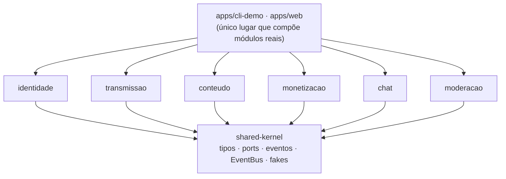
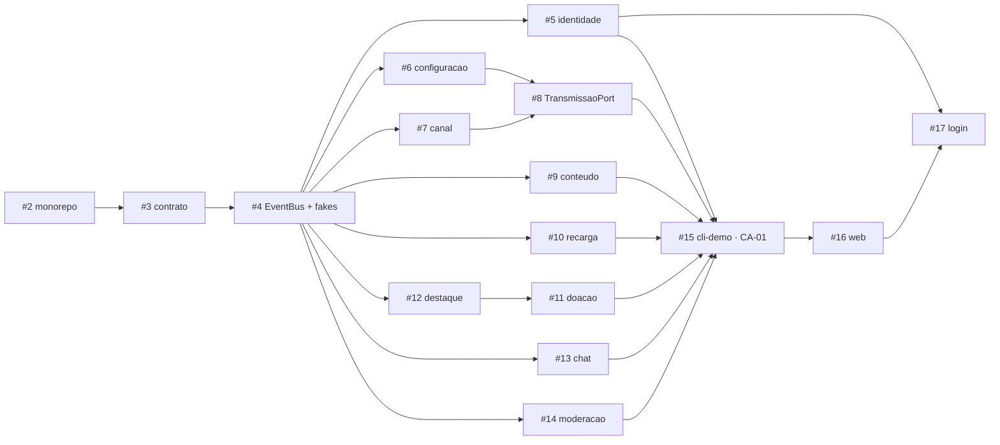

# Guia: como desenvolver sem conflito

Este repositório junta os três códigos da Entrega 03 num **monorepo** (npm workspaces) e executa o cenário arquitetural **CA-01 — Live com doação destacada**, a evidência de “algo rodando” do Documento de Arquitetura (DAS). Onze pessoas, três subequipes, um repositório: o que segue existe para que ninguém precise esperar ninguém nem sobrescrever o trabalho de outra pessoa.

## Em 30 segundos

1. Pegue **uma issue** atribuída a você e altere **só os caminhos** listados nela.
2. Seu pacote importa **apenas `@g6/shared-kernel`**, nunca outro contexto.
3. O que um contexto precisa de outro vem por **port** (interface) do shared-kernel. Enquanto o vizinho não existe, use o **fake** dele.
4. Mudou o shared-kernel? É **contrato**: issue com label `contrato` e aprovação de uma pessoa de **cada** subequipe afetada.
5. Branch `feat/<pacote>-<descricao>` → PR com `Closes #N` → 1 aprovação → merge.

## Como a integração funciona (Shared Kernel)

O **Shared Kernel** é um termo de *Domain-Driven Design* (EVANS, 2003, cap. 14): um pedaço pequeno do modelo que dois ou mais contextos combinam usar em comum. Ninguém mexe nele sozinho. Cada contexto tem o próprio modelo e não importa código dos outros; só o mínimo que precisa ser igual em todos vai para o kernel.



O kernel tem quatro tipos de coisa, e **nenhuma é regra de negócio**:

| O quê | Para quê | Exemplo |
| --- | --- | --- |
| Tipos comuns | Mesmo vocabulário em todos os contextos | `UsuarioId`, `LiveId`, `MoedaVirtual`, `Resultado<T>` |
| **Ports** | O que um contexto oferece e outro consome | `ChatPort`, `DoacaoPort`, `AutenticacaoPort` |
| Eventos de domínio | Reação sem acoplamento | `LiveIniciada`, `LiveEncerrada`, `DoacaoConfirmada`, `MensagemPublicada` |
| Fakes e suítes de contrato | Desenvolver e provar o contrato sem o vizinho | `FakeChat`, `casosChatPort` em `@g6/shared-kernel/testing` |

Os nomes e campos exatos saem das issues [#3](../../issues/3) (contrato) e [#4](../../issues/4) (EventBus e fakes). Os exemplos deste guia são ilustrativos até elas entrarem na `main`.

## Quem é dono de quê

Cada caminho tem um dono (também em [`CODEOWNERS`](CODEOWNERS), que pede a revisão automaticamente no PR). Quando dois trabalhos caem no mesmo pacote, a separação é por **pasta**, para que as issues não toquem os mesmos arquivos.

| Caminho | Conteúdo | Subequipe | Issue |
| --- | --- | --- | --- |
| `packages/shared-kernel` | contrato, EventBus, fakes | SG2 | [#3](../../issues/3) · [#4](../../issues/4) |
| `packages/identidade` | Chain of Responsibility · `AutenticacaoPort` | SG3 | [#5](../../issues/5) |
| `packages/transmissao/src/configuracao` | Builder + Director (`StreamConfig`) | SG1 | [#6](../../issues/6) |
| `packages/transmissao/src/canal` | Observer (`StreamChannel`) | SG3 | [#7](../../issues/7) |
| `packages/transmissao/src/servico` · `src/index.ts` | `TransmissaoPort` | SG1 | [#8](../../issues/8) |
| `packages/conteudo` | Factory Method (`UserContent`) | SG1 | [#9](../../issues/9) |
| `packages/monetizacao/src/recarga` | Decorator · Adapter · Proxy · `RecargaPort` | SG2 | [#10](../../issues/10) |
| `packages/monetizacao/src/doacao` | Facade + Mediator · `DoacaoPort` | SG2 | [#11](../../issues/11) |
| `packages/monetizacao/src/destaque` | Decorator da mensagem destacada | SG2 | [#12](../../issues/12) |
| `packages/chat` | Observer (`ChatRoom`) · `ChatPort` | SG3 | [#13](../../issues/13) |
| `packages/moderacao` | AutoMod + Strategy · `ModeracaoPort` | SG3 | [#14](../../issues/14) |
| `apps/cli-demo` | roteiro do CA-01 no terminal (MVP) | SG1 | [#15](../../issues/15) |
| `apps/web` (exceto `src/auth`) | página integrada | SG2 | [#16](../../issues/16) |
| `apps/web/src/auth`, `public/login.*` | login | SG3 | [#17](../../issues/17) |
| raiz (`package.json`, `tsconfig.base.json`, `.github/`, `CODEOWNERS`) | infraestrutura | SG1 | [#2](../../issues/2) · [#19](../../issues/19) |

Ordem de dependência entre as issues:



Depois que o **contrato (#3) e os fakes (#4)** entram na `main`, as issues #5 a #14 podem andar em paralelo, porque cada uma depende só do kernel.

## Regras

1. **Escopo de arquivos é lei.** Cada issue lista os caminhos que pode alterar. Precisa mexer fora disso? Comente na issue dona do caminho ou abra uma nova.
2. **Pacotes só importam `@g6/shared-kernel`.** Nunca um contexto em outro (`@g6/chat` não importa `@g6/monetizacao`). Só `apps/*` compõem módulos reais. Hoje a regra vale por convenção e revisão; a [#18](../../issues/18) vai verificá-la automaticamente.
3. **Desenvolva contra os fakes.** Enquanto o módulo vizinho não existe, use o dublê de `@g6/shared-kernel/testing`. Ninguém espera ninguém.
4. **O contrato é congelado no marco M1.** Depois disso, alterar o shared-kernel segue o [procedimento de mudança de contrato](#mudar-o-contrato-shared-kernel).
5. **Arquivos da raiz** (`package.json` raiz, `tsconfig.base.json`, `.github/`, `CODEOWNERS`) são da infraestrutura ([#2](../../issues/2), [#19](../../issues/19)). Dependência nova vai no `package.json` **do próprio pacote**, nunca na raiz.
6. **Cada pacote mantém o executor de testes do código de origem** (Vitest na SG1, Jest + SWC na SG2, `node:test` via `tsx` na SG3). Não padronize: o código da E03 entra sem reescrever os testes.
7. **Importação do código da E03 em dois commits** (veja abaixo), para a autoria do trabalho novo da E04 ficar legível no quadro de participações.
8. **Sem segredo no repositório.** Chaves de gateway de pagamento (modo de teste) só por `.env`, que está no `.gitignore`. Por padrão, rode com o gateway simulado.
9. **Nada direto na `main`.**

## Passo a passo de uma tarefa

```bash
git switch main && git pull
git switch -c feat/<pacote>-<descricao>        # ex.: feat/chat-chatroom
npm install                                    # só se o package-lock.json mudou
# ... trabalhe só nos caminhos da sua issue ...
npm run typecheck && npm test                  # tudo verde na raiz antes do PR
git push -u origin feat/<pacote>-<descricao>
```

Abra o PR com `Closes #N` (o template já traz o checklist). Para rodar só o seu pacote: `npm test -w @g6/<pacote>` e `npm run typecheck -w @g6/<pacote>`.

**Commits:** Conventional Commits com o pacote como escopo, em inglês, imperativo, até 72 caracteres: `feat(chat): publish highlighted message`, `test(identidade): cover step-up denial`.

### Importar código da Entrega 03

Cada subequipe tem o código de origem em um repositório da E03:

| Subequipe | Repositório de origem |
| --- | --- |
| SG1 | [`g6-streaming-entrega03-subgrupo01-codigo`](https://github.com/UnBArqDsw2026-2-Turma01/g6-streaming-entrega03-subgrupo01-codigo) |
| SG2 | [`2026.2-T01-_G6_ProjetoStreamingVideo_SubEquipe02_Codigo`](https://github.com/UnBArqDsw2026-2-Turma01/2026.2-T01-_G6_ProjetoStreamingVideo_SubEquipe02_Codigo) |
| SG3 | [`g6-streaming-entrega03-subgrupo03-codigo`](https://github.com/UnBArqDsw2026-2-Turma01/g6-streaming-entrega03-subgrupo03-codigo) |

Primeiro commit: **cópia literal**, sem nenhuma edição. Segundo (e seguintes): a adaptação ao monorepo.

```bash
# clone FORA do repositório, para não versionar o .git de origem
git clone --depth 1 <repo-de-origem> /tmp/e03-origem
SHA=$(git -C /tmp/e03-origem rev-parse --short HEAD)

cp -r /tmp/e03-origem/src/<pasta-do-padrao>/. packages/<pacote>/src/<pasta>/
git add packages/<pacote>
git commit -m "chore(<pacote>): import from <repo-de-origem>@$SHA"

# agora sim: trocar tipos locais pelos do shared-kernel, ajustar imports, portar os testes
git commit -m "refactor(<pacote>): adapt to shared-kernel contract"
```

Se o código importado não passar no `typecheck` do monorepo, corrija no **segundo** commit. O primeiro nunca é editado.

### Desenvolver contra os fakes

O pacote consome o port, não o vizinho. O fake registra as chamadas e pode ser configurado para falhar, o que permite testar também o caminho de erro (exemplo: a doação continua válida mesmo que o chat falhe).

```ts
// packages/monetizacao/test/doacao — ilustrativo; nomes finais saem das issues #3 e #4
import { FakeChat } from '@g6/shared-kernel/testing';

const chat = new FakeChat({ falhar: true });
const doacao = new ServicoDoacao({ chat /* ... */ });

const resultado = await doacao.doar(sessao, live, 50, 'salve!');
// a doação e o repasse foram concluídos, apesar da falha do chat
```

Para provar que o fake e a implementação real se comportam igual, a mesma **suíte de contrato** roda contra os dois (ex.: `casosChatPort`). Ela devolve `[{ nome, executar }]`, e cada pacote a embrulha no executor que usa (`test`/`it`), então funciona em Jest, Vitest e `node:test`.

## Mudar o contrato (shared-kernel)

**Antes do marco M1** o contrato ainda está sendo desenhado: comente na issue [#3](../../issues/3).

**Depois do M1** ele está congelado. Para mudar:

1. Abra uma issue com o label **`contrato`** descrevendo: o que muda, **quem provê** e **quem consome** o port, e o motivo.
2. Marque, na issue, uma pessoa de **cada** subequipe afetada (quem provê e quem consome).
3. O PR só entra com aprovação dessas pessoas. Se a mudança quebrar um fake ou uma suíte de contrato, o mesmo PR já os atualiza.
4. Avise no grupo: a mudança vale para todos os pacotes que importam o tipo.

Prefira **estender** (campo opcional, evento novo) a **alterar** (renomear, mudar tipo): estender não quebra quem já consome.

## Conflitos

- **`package-lock.json`:** é o único arquivo compartilhado inevitável. Em conflito, aceite a versão da `main`, rode `npm install` e faça commit do lock regenerado. Nunca resolva à mão.
- **Dois PRs no mesmo pacote:** só acontece quando as pastas são distintas por issue (ver a tabela). Se duas issues precisam do mesmo arquivo, combinem na issue antes de começar.
- **Branch desatualizada:** `git fetch && git rebase origin/main` na **sua** branch ainda não publicada, ou `git merge origin/main` se já estiver em PR. Nunca `push --force` em branch de outra pessoa.

## Revisão e merge

A `main` está protegida:

- só entra por **pull request**, com **1 aprovação** (aprovações antigas são descartadas se o código mudar depois);
- conversas de revisão precisam estar **resolvidas**;
- **force push e exclusão** da `main` estão bloqueados.

O [`CODEOWNERS`](CODEOWNERS) pede a revisão do dono do caminho automaticamente. Quem **revisa** é indicado em cada issue (revisão cruzada entre subequipes sempre que possível). Administradores do repositório conseguem ignorar a proteção, e isso é reservado para emergência, não para atalho.

Ainda **não há verificação automática** (CI): ela vem com a [#19](../../issues/19), e então o PR também exigirá `typecheck` e testes verdes. Até lá, rode `npm run typecheck && npm test` antes de pedir revisão.

## Perguntas frequentes

**Preciso de uma função de outro pacote. Posso importar?** Não. Se já existe um port, use-o. Se não existe, abra uma issue `contrato` pedindo o port. Se for só reação a algo que aconteceu, use um **evento** do EventBus.

**O vizinho ainda não terminou. Fico parado?** Não: o fake do port existe justamente para isso. Só `apps/*` precisam dos módulos reais.

**Meu teste precisa de dois contextos juntos.** Esse é um teste de integração e fica em `apps/*` (ex.: o do CA-01 em `apps/cli-demo`), não dentro de um pacote.

**Posso adicionar uma biblioteca?** Sim, no `package.json` do **seu** pacote, citando o motivo no PR. Biblioteca na raiz só pela infraestrutura.

**Onde está o planejamento completo?** Na página [Planejamento](https://unbarqdsw2026-2-turma01.github.io/2026.2-T01-_G6_ProjetoStreamingVideo_Entrega_04/#/Projeto/Planejamento.md) do Pages da Entrega 04.

## Referências

- EVANS, Eric. *Domain-Driven Design: Tackling Complexity in the Heart of Software*. Addison-Wesley, 2003. Cap. 14, “Maintaining Model Integrity” (Shared Kernel).
- GAMMA, E.; HELM, R.; JOHNSON, R.; VLISSIDES, J. *Padrões de Projeto: soluções reutilizáveis de software orientado a objetos*. Porto Alegre: Bookman, 2000.
- [Conventional Commits 1.0.0](https://www.conventionalcommits.org/pt-br/v1.0.0/).
- [npm workspaces](https://docs.npmjs.com/cli/using-npm/workspaces).
