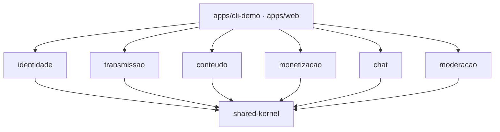

# Streaming de Vídeo — Entrega 04 · Código

Monorepo do **Grupo 06** (FGA0208 · UnB · 2026.2) que junta os três códigos da Entrega 03 e executa o cenário arquitetural **CA-01 — Live com doação destacada**, a evidência executável do Documento de Arquitetura (DAS).

- **Documentação:** [GitHub Pages da Entrega 04](https://unbarqdsw2026-2-turma01.github.io/2026.2-T01-_G6_ProjetoStreamingVideo_Entrega_04/)
- **Regras de trabalho:** [guia fixado (#1)](https://github.com/UnBArqDsw2026-2-Turma01/2026.2-T01-_G6_ProjetoStreamingVideo_Entrega_04_Codigo/issues/1) · **Contrato:** [#3](https://github.com/UnBArqDsw2026-2-Turma01/2026.2-T01-_G6_ProjetoStreamingVideo_Entrega_04_Codigo/issues/3)

## Como a integração funciona

Cada contexto é um pacote independente que só conhece o **shared kernel** (`@g6/shared-kernel`): tipos comuns, *ports* (interfaces) e eventos de domínio. Cada subequipe desenvolve e testa o próprio pacote contra os *fakes* do contrato (`@g6/shared-kernel/testing`), sem esperar as outras. Os módulos reais só se encontram em `apps/`.



## Estrutura

| Pacote | Conteúdo | Testes | Issue |
| --- | --- | --- | --- |
| [`packages/shared-kernel`](packages/shared-kernel) | Contrato de integração: tipos comuns, ports, eventos de domínio e EventBus. | node:test | #3, #4 |
| [`packages/identidade`](packages/identidade) | Contexto de identidade e acesso (Chain of Responsibility) · AutenticacaoPort. | node:test | #5 |
| [`packages/transmissao`](packages/transmissao) | Contexto de transmissão: configuração (Builder) e canal (Observer) · TransmissaoPort. | Vitest + node:test | #6, #7, #8 |
| [`packages/conteudo`](packages/conteudo) | Contexto de conteúdo gerado pelo usuário (Factory Method) · reage a LiveEncerrada. | Vitest | #9 |
| [`packages/monetizacao`](packages/monetizacao) | Contexto de monetização: recarga (Decorator · Adapter · Proxy), doação (Facade + Mediator) e mensagem destacada (Decorator). | Jest | #10, #11, #12 |
| [`packages/chat`](packages/chat) | Contexto de chat em tempo real (Observer) · ChatPort. | node:test | #13 |
| [`packages/moderacao`](packages/moderacao) | Contexto de moderação (AutoMod + Strategy) · ModeracaoPort. | node:test | #14 |
| [`apps/cli-demo`](apps/cli-demo) | Roteiro do CA-01 no terminal | node:test | #15 |
| [`apps/web`](apps/web) | Página integrada do CA-01 | node:test | #16, #17 |

Cada pacote mantém o executor de testes do código de origem na Entrega 03 (Vitest na SubEquipe_01, Jest na SubEquipe_02, `node:test` na SubEquipe_03). Os pacotes expõem o próprio TypeScript (`exports` → `src/index.ts`) e não há etapa de build: o código roda com `tsx`, como nos três repositórios da E03.

## Pré-requisitos

Node.js **22 ou superior** (exigido pelo código da SubEquipe_01) e npm.

## Comandos

```bash
npm install          # instala e liga os workspaces
npm run typecheck    # checagem de tipos em todos os pacotes
npm test             # testes de todos os pacotes
npm run check        # typecheck + test
npm run demo         # CA-01 no terminal (apps/cli-demo)
npm run web          # página integrada (apps/web)

npm test -w @g6/chat # só um pacote
```

## Regras em uma linha cada

1. Altere só os caminhos do **Escopo de arquivos** da sua issue (os donos estão em [`CODEOWNERS`](CODEOWNERS)).
2. Pacote importa só `@g6/shared-kernel`; só `apps/*` compõem módulos.
3. Contrato congelado no M1: mudança no shared-kernel exige issue com label `contrato` e aprovação das subequipes afetadas.
4. Dependência nova vai no `package.json` do próprio pacote; conflito em `package-lock.json` → aceite o da `main` e rode `npm install`.
5. Código da E03 entra em um commit `chore(<pacote>): import from <repo>@<sha>`, separado da adaptação.
6. Branch `feat/<pacote>-<descricao>`, PR com `Closes #N`, Conventional Commits com o pacote como escopo.
7. Sem segredo no repositório: credenciais de gateway só em `.env` (ignorado pelo git).
